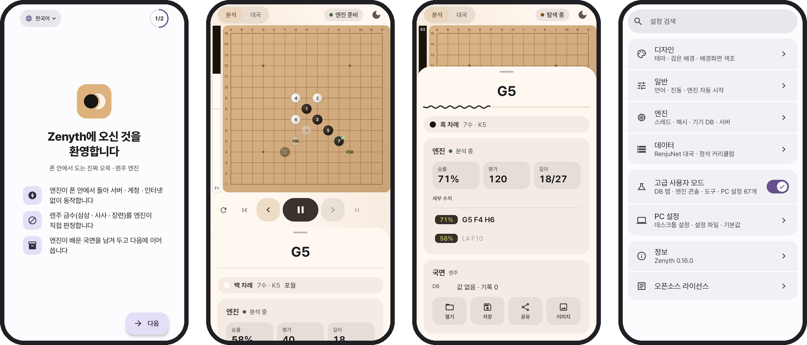

<div align="center">

<picture>
  <source media="(prefers-color-scheme: dark)" srcset="docs/readme/logo/zenyth-lockup-dark.svg">
  <source media="(prefers-color-scheme: light)" srcset="docs/readme/logo/zenyth-lockup-light.svg">
  
</picture>

<p>
  <b>진짜 엔진이 폰 안에서 도는 오목 · 렌주 보드.</b><br>
  서버도, 계정도 필요 없고 오프라인에서 동작합니다. 엔진은 <a href="https://github.com/dhbloo/rapfi">Rapfi</a> 입니다.
</p>

<p>
  <a href="https://github.com/lowqen/Zenyth/actions/workflows/build.yml"></a>
  <a href="https://github.com/lowqen/Zenyth/releases/latest"></a>
  <a href="#라이선스"></a>
  
</p>

</div>

<p align="center">
  <a href="https://github.com/lowqen/Zenyth/releases/latest">
    <picture>
      <source media="(prefers-color-scheme: dark)" srcset="docs/readme/badges/release-dark.svg">
      
    </picture>
  </a>
  <a href="https://github.com/ImranR98/Obtainium">
    <picture>
      <source media="(prefers-color-scheme: dark)" srcset="docs/readme/badges/obtainium-dark.svg">
      
    </picture>
  </a>
</p>

<p align="center">
  <a href="https://zenythweb.pages.dev">
    <picture>
      <source media="(prefers-color-scheme: dark)" srcset="docs/readme/badges/web-dark.svg">
      
    </picture>
  </a>
  <a href="README.md">
    <picture>
      <source media="(prefers-color-scheme: dark)" srcset="docs/readme/badges/readme-en-dark.svg">
      
    </picture>
  </a>
</p>

## <picture><source media="(prefers-color-scheme: dark)" srcset="docs/readme/sections/screenshots-dark.svg"></picture> 화면

<picture>
  <source media="(prefers-color-scheme: dark)" srcset="docs/readme/showcase-dark.png">
  
</picture>

<p align="center"><sub>한국어 · English · 简体中文 을 지원합니다.</sub></p>

---

## <picture><source media="(prefers-color-scheme: dark)" srcset="docs/readme/sections/features-dark.svg"></picture> 기능

<table>
  <tr>
    <td width="50%" valign="top">
      <p>
        <picture>
          <source media="(prefers-color-scheme: dark)" srcset="docs/readme/features/engine-dark.svg">
          
        </picture>
        <br><b>엔진이 폰 안에</b>
      </p>
      <p>
        가장 강한 공개 오목 엔진 가운데 하나인 Rapfi 를 arm64 로 컴파일해 진짜 프로세스로
        띄웁니다. PC 와 똑같은 수를 찾고, 코어 전부와 최신 폰의 빠른 명령어를 쓰며,
        폰이 뜨거워지면 코어를 돌려줍니다.
      </p>
    </td>
    <td width="50%" valign="top">
      <p>
        <picture>
          <source media="(prefers-color-scheme: dark)" srcset="docs/readme/features/analysis-dark.svg">
          
        </picture>
        <br><b>분석 보드</b>
      </p>
      <p>
        최선수 · 승률 · 평가 · 깊이, 평가 바, 합법 착점 전부의 값 오버레이, 끌어서 수를
        옮기는 형세 그래프. 분석과 대국은 판이 따로라 분석에서 늘어놓은 수가 기보에
        섞이지 않습니다.
      </p>
    </td>
  </tr>
  <tr>
    <td width="50%" valign="top">
      <p>
        <picture>
          <source media="(prefers-color-scheme: dark)" srcset="docs/readme/features/play-dark.svg">
          
        </picture>
        <br><b>엔진과 대국</b>
      </p>
      <p>
        흑/백 · 룰 · 시간 제어, 노드로 정하는 레벨 5단. 무제한으로 생각할 때는
        「지금 두기」, 그리고 되돌리기 · 다시 하기 · 분기 이동.
      </p>
    </td>
    <td width="50%" valign="top">
      <p>
        <picture>
          <source media="(prefers-color-scheme: dark)" srcset="docs/readme/features/rules-dark.svg">
          
        </picture>
        <br><b>프리스타일 · 표준 · 렌주</b>
      </p>
      <p>
        규칙마다 전용 신경망을 모두 동봉했습니다. 렌주 금수(삼삼 · 사사 · 장련)는
        두는 대로 표시되고, 근사치가 아니라 <b>엔진이 직접</b> 판정합니다.
      </p>
    </td>
  </tr>
  <tr>
    <td width="50%" valign="top">
      <p>
        <picture>
          <source media="(prefers-color-scheme: dark)" srcset="docs/readme/features/review-dark.svg">
          
        </picture>
        <br><b>리뷰와 증명</b>
      </p>
      <p>
        끝난 판을 한 수씩 되짚으며 평가가 실제로 뒤집힌 지점을 엔진이 짚어 줍니다.
        평가만이 아니라 국면 증명도 시킬 수 있고, 깊이 예산은 직접 정합니다.
      </p>
    </td>
    <td width="50%" valign="top">
      <p>
        <picture>
          <source media="(prefers-color-scheme: dark)" srcset="docs/readme/features/openings-dark.svg">
          
        </picture>
        <br><b>오프닝 익스플로러</b>
      </p>
      <p>
        1~4수 이름 249개, 흑 5수 유불리 11등급(모양 1,889개), 환원 수순, 26주형 랭킹.
        폰에서 직접 만든 실전 통계를 더할 수 있습니다.
      </p>
    </td>
  </tr>
  <tr>
    <td width="50%" valign="top">
      <p>
        <picture>
          <source media="(prefers-color-scheme: dark)" srcset="docs/readme/features/joseki-dark.svg">
          
        </picture>
        <br><b>정석</b>
      </p>
      <p>
        공식 커리큘럼을 살펴보거나 직접 수순을 맞히며 배웁니다(힌트 · 점수 · 진도).
        새 레슨은 앱 업데이트 없이 들어옵니다. 갈래와 메모를 단 내 정석은 어느
        국면에서든 다시 찾을 수 있습니다.
      </p>
    </td>
    <td width="50%" valign="top">
      <p>
        <picture>
          <source media="(prefers-color-scheme: dark)" srcset="docs/readme/features/offline-dark.svg">
          
        </picture>
        <br><b>오프라인, 내 폰 안에서</b>
      </p>
      <p>
        비행기 모드에서 동작합니다. 엔진이 배운 국면은 폰 안의 데이터베이스에 남습니다.
        <code>.psq</code> / <code>.sav</code> 열기 · 저장, 데스크톱 <code>settings.txt</code>
        가져오기 — Yixin-Board 설정 67개가 모두 있습니다.
      </p>
    </td>
  </tr>
</table>

---

## <picture><source media="(prefers-color-scheme: dark)" srcset="docs/readme/sections/download-dark.svg"></picture> 내려받기

[최신 릴리스](https://github.com/lowqen/Zenyth/releases/latest)에서 APK 를 받으세요.
스토어 없이 업데이트 알림을 받으려면 [Obtainium](https://github.com/ImranR98/Obtainium)에
이 저장소 주소를 추가하면 됩니다.

| 필요한 것 | |
|---|---|
| Android | 8.0(API 26) 이상 |
| CPU | **arm64**. 옛 armeabi · x86 기기에서는 엔진이 돌지 않습니다. |
| 저장 공간 | 약 90 MB. 신경망이 APK 안에 들어 있어 처음 실행할 때 받는 것이 없습니다. |

<details>
<summary><b>받은 APK 확인하기</b></summary>
<br>

모든 릴리스 APK 는 같은 키로 서명됩니다. 그 인증서의 SHA-256 은

```
F8:30:FF:50:9B:96:CB:A8:01:3E:B0:0D:1B:DB:C2:F4:FE:EF:41:C9:35:03:D5:06:B3:C9:DA:65:22:A9:B9:2E
```

다른 키로 서명된 APK 는 이름이 무엇이든 이 프로젝트에서 나온 것이 아닙니다.

* **폰에서**: [AppVerifier](https://github.com/soupslurpr/AppVerifier). 설치된 앱을 공유하거나,
  `dev.gomoku.rapfidroid` 와 다음 줄에 위 지문을 붙여 넣습니다.
* **Android SDK 로**: `apksigner verify --print-certs Zenyth-x.y.z.apk` 가
  `certificate SHA-256 digest: f830ff50…b92e` 를 출력합니다.
* **어디서 빌드됐는지**: `gh attestation verify Zenyth-x.y.z.apk -R lowqen/Zenyth` 가 그 파일을
  만든 커밋과 워크플로의 서명된 출처 기록을 확인합니다(v0.16.0 이후 릴리스).

Android 는 다른 키로 서명된 업데이트를 거부하므로, 이 확인은 처음 설치할 때 가장 중요합니다.
F-Droid 판은 F-Droid 의 키로 서명되어 지문이 다릅니다.

</details>

---

## <picture><source media="(prefers-color-scheme: dark)" srcset="docs/readme/sections/engine-dark.svg"></picture> 엔진이 폰에서 도는 방법

Android 10 부터 앱은 패키지 관리자가 네이티브 라이브러리 폴더에 풀어 둔 파일만, 그것도
이름이 `lib*.so` 일 때만 실행할 수 있습니다. 그래서 엔진은 `libengine.so` 라는 이름의 평범한
PIE 실행 파일로 빌드되고, 데스크톱과 같은 piskvork 프로토콜로 stdin · stdout 을 주고받는
**별도 프로세스**로 뜹니다. 화면은 데스크톱 [Yixin-Board](https://github.com/dhbloo/Yixin-Board)
연구 환경을 옮긴 것이라 엔진 매개변수 전부가 축소 없이 넘어왔습니다.

<details>
<summary><b>왜 JNI 가 아니라 프로세스인가요?</b></summary>
<br>

1. Rapfi 는 해시 테이블을 잡지 못하면 `exit` 를 부릅니다. 앱 프로세스 안이라면 스택 트레이스도 없는 크래시입니다.
2. 엔진은 작업 디렉터리를 바꿉니다. 라이브러리가 호스트에게 이러면 상관없는 코드가 깨집니다.
3. 탐색은 앱을 되감지 않고 취소할 수 있어야 합니다.
4. GPL-3.0 코드와 BSD-2-Clause 앱 사이의 경계를 깨끗하게 지킵니다.

</details>

<details>
<summary><b>폰 빌드가 맞다는 건 어떻게 아나요?</b></summary>
<br>

Rapfi 의 탐색 결과는 컴파일한 명령어 집합과 무관합니다(upstream 이 `-ffp-contract=off` 로
빌드). 그래서 `BENCH` 명령은 폰에서도 x86 호스트와 같은 해시 `e240ab16` 을 내야 합니다.
[빌드 스크립트](tools/build_engine_android.sh)는 aarch64 가 아니거나, `libc++_shared` 에
기대거나, 그 플래그를 잃은 바이너리를 내지 않습니다. CI 는 엔진을 소스에서 다시 빌드해
커밋된 바이너리와 대조합니다.

</details>

---

## <picture><source media="(prefers-color-scheme: dark)" srcset="docs/readme/sections/faq-dark.svg"></picture> 자주 묻는 질문

<details>
<summary><b>오프닝 승률은 어디서 오나요?</b></summary>
<br>

[RenjuNet](https://www.renju.net/game/) 대국 데이터베이스입니다 — 단, 직접 추가했을 때만.
그 라이선스는 오프라인 개인 사용을 허락하고, 내용이나 **그로부터 파생된 모든 것**을 웹사이트 ·
온라인 시스템에 넣는 것을 금지합니다. 그래서 데이터는 동봉하지도, 호스팅하지도, 받아 오지도
않습니다. 앱이 변환 과정을 통째로 갖고 있어 폰에서 직접 통계를 만듭니다.

> 설정 ▸ **대국 데이터 추가** ▸ renju.net 열기 ▸ 받아 둔 XML 파일 고르기 ▸ 만들기

43 MB XML 을 정수 열로 흘려 읽고, 모든 앞 수순 국면을 64비트 증분 Zobrist 정규 해시로 세고,
기수 정렬 한 번으로 팩을 만듭니다. 몇 초면 끝나고, 결과는 폰 밖으로 나가지 않습니다.

</details>

<details>
<summary><b>앱이 네트워크를 쓰나요?</b></summary>
<br>

한 번, 그리고 끌 수 있습니다. 정석 탭이 Zenyth Web 이 싣는 정적 파일
`https://zenythweb.pages.dev/joseki/curriculum.json` 에서 공식 커리큘럼을 받아 옵니다. 사용자 · 기보 ·
기기에 관한 것은 아무것도 보내지 않고, 바뀌지 않은 파일은 빈 응답으로 끝납니다.
**설정 ▸ 정석 커리큘럼 자동 업데이트** 로 끕니다. 그 밖의 모든 것은 비행기 모드에서 동작합니다.

</details>

<details>
<summary><b>엔진을 PC 에서 돌릴 수도 있나요?</b></summary>
<br>

네. 서버 모드는 다른 컴퓨터의 Rapfi 와 통신합니다 — 아주 큰 오프닝 데이터베이스나 몇 시간씩
걸어 두는 분석에 씁니다. **기본으로 꺼져 있고** 고급 스위치 뒤에 있습니다.

연결은 piskvork 를 말하는 평문 TCP 라 자체 암호화 · 비밀번호가 없습니다. 그래서 Zenyth 는
[Tailscale](https://tailscale.com) 안에서 쓰는 것을 전제로 하고, Tailscale 도 사설망도 아닌 주소에는
경고를 띄웁니다. 서버 쪽에서는:

* **tailnet 에서만 listen.** `ss -ltnp | grep 5050` 이 `0.0.0.0:5050` · `*:5050` 이 아니라
  `100.x.y.z:5050` 을 보여야 합니다.
* **내 기기만 들이기.** Tailscale 기본 정책은 모든 기기가 모든 포트에 닿게 합니다. 「모두 허용」
  규칙을 이런 규칙으로 바꾸세요.

  ```json
  "tagOwners": { "tag:rapfi-server": ["autogroup:admin"] },
  "grants": [
    { "src": ["you@example.com"], "dst": ["tag:rapfi-server"], "ip": ["tcp:5050"] }
  ]
  ```

</details>

<details>
<summary><b>왜 arm64 만 되나요?</b></summary>
<br>

엔진은 arm64-v8a 용으로 빌드 · 검증한 네이티브 코드이고, 요즘 안드로이드 폰은 사실상 모두
arm64 입니다. CPU 에 내적 명령어가 있으면 더 빠른 dotprod 빌드를, 없으면 NEON 빌드를 실행할
때 고릅니다.

</details>

<details>
<summary><b>왜 Google Play 에 없나요?</b></summary>
<br>

APK 에 GPL-3.0 인 Rapfi 가 들어 있고, GPL-3.0 제6조 · 제10조가 Play 배포 약관과 충돌해 올릴 수
없습니다. 선택이 아니라 라이선스의 결과입니다. GitHub Releases · Obtainium · F-Droid 가 GPL 앱의
본래 자리이고, F-Droid 레시피는 [`fdroid/`](fdroid/) 에 있습니다.

</details>

<details>
<summary><b>Rapfi 공식 앱인가요?</b></summary>
<br>

아닙니다. Zenyth 는 비공식 이식판입니다. Rapfi 는 [dhbloo](https://github.com/dhbloo) 의 작품이고,
이 프로젝트는 그것을 안드로이드용으로 묶고 연구용 화면을 얹었습니다. 예전 이름은 RapfiDroid 입니다.

</details>

---

## <picture><source media="(prefers-color-scheme: dark)" srcset="docs/readme/sections/development-dark.svg"></picture> 개발

```bash
git clone https://github.com/lowqen/Zenyth.git
cd Zenyth
./gradlew testDebugUnitTest assembleDebug
```

JDK 17 과 최신 Android Studio(AGP 9.5, compileSdk 37). 빌드된 `libengine.so` 가 커밋돼 있어
클론하자마자 빌드됩니다. [`tools/build_engine_android.sh`](tools/build_engine_android.sh) 가 엔진을
다시 빌드 · 검증하고, [`ENGINE_VERSION.txt`](app/src/main/jniLibs/ENGINE_VERSION.txt) 에 정확한 엔진
커밋이 적혀 있습니다. 단위 테스트와 스크린샷 골든은 push 마다 돕니다.

```
app/src/main/java/dev/gomoku/zenyth/
  core/      보드 모델, 국면 키, 설정 표, 디자인 시스템
  data/      엔진 연결, 저장소, 팩 · 데이터베이스 입출력
  domain/    엔진 세션, RIF 파싱, 집계, 팩 쓰기
  feature/   보드, 연구, 정석, 연결, 설정, 온보딩
tools/       엔진 크로스 컴파일, 패치, PGO 프로필
fdroid/      F-Droid 메타데이터와 빌드 레시피
docs/        배포, 개발 기록, 릴리스 노트
```

릴리스는 태그 하나로 끝납니다. CI 가 RenjuNet 파생 데이터가 든 빌드나 Android 가 실행할 수 없는
엔진을 거부합니다 — [docs/publishing.md](docs/publishing.md). 설계 결정과 측정은
[docs/engineering-notes.md](docs/engineering-notes.md), 보안 제보는 [SECURITY.md](SECURITY.md).

---

## <picture><source media="(prefers-color-scheme: dark)" srcset="docs/readme/sections/credits-dark.svg"></picture> 감사

<p align="center">
  <a href="https://github.com/dhbloo/rapfi"><b>Rapfi</b></a> &nbsp;·&nbsp;
  <a href="https://github.com/dhbloo/rapfi-networks"><b>rapfi-networks</b></a> &nbsp;·&nbsp;
  <a href="https://github.com/dhbloo/Yixin-Board"><b>Yixin-Board</b></a> &nbsp;·&nbsp;
  <a href="https://github.com/accreator/Yixin-Board"><b>Yixin-Board (Kai Sun)</b></a> &nbsp;·&nbsp;
  <a href="https://www.renju.net/"><b>RenjuNet</b></a> &nbsp;·&nbsp;
  <a href="https://github.com/orioncactus/pretendard"><b>Pretendard</b></a>
</p>

[dhbloo](https://github.com/dhbloo) 는 이 앱을 쓸 만하게 만드는 엔진 Rapfi 와, 이 화면이 따르는
Yixin-Board 포크를 만들었습니다. Kai Sun 은 원래의 Yixin-Board(BSD-2-Clause, 2009 ~ 2017)를
만들었습니다. 신경망 가중치는 CC0 1.0 입니다. 이들 누구에게도 허락이 필요하지 않았고 구하지도
않았습니다 — 라이선스가 요구하는 것은 고지와 소스이고, 둘 다 여기 있습니다.

---

## <picture><source media="(prefers-color-scheme: dark)" srcset="docs/readme/sections/licence-dark.svg"></picture> 라이선스

Zenyth 자체 소스는 **BSD-2-Clause** 입니다. 배포되는 APK 에는 **GPL-3.0-or-later** 인 Rapfi 엔진도
들어 있으므로, 패키지 전체는 GPL-3.0-or-later 로 배포됩니다.

각 릴리스에 든 엔진의 대응 소스는 **[lowqen/rapfi](https://github.com/lowqen/rapfi)** 의 `android`
브랜치, 태그 `zenyth-v<버전>` 입니다: upstream `3c94c2a9` 위에 안드로이드 빌드용
`Rapfi/CMakeLists.txt` 블록 둘과 결과가 바뀌지 않는 속도 패치들, 각각 커밋 하나씩. 제3자 고지 전체는
[LICENSES.md](LICENSES.md) 에 있고, GPL-3.0 · BSD-2-Clause 전문은 앱의 설정 ▸ 오픈소스 라이선스에
들어 있습니다.

> [!TIP]
> **저장소에 Star** 를 누르면 새 릴리스 알림을 GitHub 에서 바로 받을 수 있습니다.
