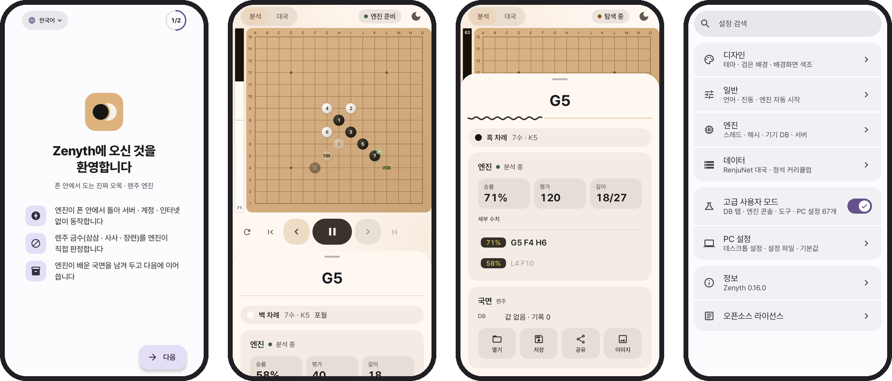

<div align="center">

<picture>
  <source media="(prefers-color-scheme: dark)" srcset="docs/readme/logo/zenyth-lockup-dark.svg">
  <source media="(prefers-color-scheme: light)" srcset="docs/readme/logo/zenyth-lockup-light.svg">
  
</picture>

<p>
  <b>A gomoku and renju board with a real engine running on your phone.</b><br>
  No server. No account. Works offline. Powered by <a href="https://github.com/dhbloo/rapfi">Rapfi</a>.
</p>

<p>
  <a href="https://github.com/lowqen/Zenyth/actions/workflows/build.yml"></a>
  <a href="https://github.com/lowqen/Zenyth/releases/latest"></a>
  <a href="#licence"></a>
  
</p>

</div>

<p align="center">
  <a href="https://github.com/lowqen/Zenyth/releases/latest">
    <picture>
      <source media="(prefers-color-scheme: dark)" srcset="docs/readme/badges/release-dark.svg">
      
    </picture>
  </a>
  <a href="https://github.com/ImranR98/Obtainium">
    <picture>
      <source media="(prefers-color-scheme: dark)" srcset="docs/readme/badges/obtainium-dark.svg">
      
    </picture>
  </a>
</p>

<p align="center">
  <a href="https://rapfiweb.pages.dev">
    <picture>
      <source media="(prefers-color-scheme: dark)" srcset="docs/readme/badges/web-dark.svg">
      
    </picture>
  </a>
  <a href="README.ko.md">
    <picture>
      <source media="(prefers-color-scheme: dark)" srcset="docs/readme/badges/readme-ko-dark.svg">
      
    </picture>
  </a>
</p>

## <picture><source media="(prefers-color-scheme: dark)" srcset="docs/readme/sections/screenshots-dark.svg"></picture> Screenshots

<picture>
  <source media="(prefers-color-scheme: dark)" srcset="docs/readme/showcase-dark.png">
  
</picture>

<p align="center"><sub>Shown in Korean. The app speaks English, Korean and Simplified Chinese (简体中文).</sub></p>

---

## <picture><source media="(prefers-color-scheme: dark)" srcset="docs/readme/sections/features-dark.svg"></picture> Features

<table>
  <tr>
    <td width="50%" valign="top">
      <p>
        <picture>
          <source media="(prefers-color-scheme: dark)" srcset="docs/readme/features/engine-dark.svg">
          
        </picture>
        <br><b>The engine is on your phone</b>
      </p>
      <p>
        Rapfi, one of the strongest open gomoku engines, compiled for arm64 and
        run as a real process. It finds exactly the moves it finds on a PC, uses
        every core and the fast instructions modern phones have, and gives cores
        back when the phone gets hot.
      </p>
    </td>
    <td width="50%" valign="top">
      <p>
        <picture>
          <source media="(prefers-color-scheme: dark)" srcset="docs/readme/features/analysis-dark.svg">
          
        </picture>
        <br><b>Analysis board</b>
      </p>
      <p>
        Best move, win rate, eval and depth, an eval bar, a value overlay on
        every legal point and an evaluation graph you can scrub. Analysis and
        Play each keep their own board, so explored lines never leak into the
        game record.
      </p>
    </td>
  </tr>
  <tr>
    <td width="50%" valign="top">
      <p>
        <picture>
          <source media="(prefers-color-scheme: dark)" srcset="docs/readme/features/play-dark.svg">
          
        </picture>
        <br><b>Play the engine</b>
      </p>
      <p>
        Pick colours, rules and a time control, and five strength levels set by
        nodes. "Move now" when the engine thinks without a limit, plus undo,
        redo and branch navigation.
      </p>
    </td>
    <td width="50%" valign="top">
      <p>
        <picture>
          <source media="(prefers-color-scheme: dark)" srcset="docs/readme/features/rules-dark.svg">
          
        </picture>
        <br><b>Freestyle, standard and renju</b>
      </p>
      <p>
        Each rule has its own neural network, all bundled. Renju forbidden
        points (double three, double four, overline) are marked as you play,
        judged by the engine itself rather than approximated.
      </p>
    </td>
  </tr>
  <tr>
    <td width="50%" valign="top">
      <p>
        <picture>
          <source media="(prefers-color-scheme: dark)" srcset="docs/readme/features/review-dark.svg">
          
        </picture>
        <br><b>Review and proof</b>
      </p>
      <p>
        Walk a finished game move by move with the engine marking where the
        evaluation actually turned. Ask it to prove a position rather than only
        evaluate it, with a depth budget you control.
      </p>
    </td>
    <td width="50%" valign="top">
      <p>
        <picture>
          <source media="(prefers-color-scheme: dark)" srcset="docs/readme/features/openings-dark.svg">
          
        </picture>
        <br><b>Opening explorer</b>
      </p>
      <p>
        249 named openings, an eleven-grade evaluation of Black's fifth move over
        1,889 shapes, the transpositions between them, and rankings of the 26
        classical openings. Add real game statistics built on your own phone.
      </p>
    </td>
  </tr>
  <tr>
    <td width="50%" valign="top">
      <p>
        <picture>
          <source media="(prefers-color-scheme: dark)" srcset="docs/readme/features/joseki-dark.svg">
          
        </picture>
        <br><b>Joseki</b>
      </p>
      <p>
        An official curriculum of lessons to browse or play through yourself,
        with hints, a score and progress; new lessons arrive without an app
        update. Keep your own joseki with branches and notes, found again from
        any position.
      </p>
    </td>
    <td width="50%" valign="top">
      <p>
        <picture>
          <source media="(prefers-color-scheme: dark)" srcset="docs/readme/features/offline-dark.svg">
          
        </picture>
        <br><b>Yours, offline</b>
      </p>
      <p>
        Works in airplane mode. The engine keeps what it learns in a database on
        your phone. Open and save <code>.psq</code> / <code>.sav</code>, and
        bring over the desktop's <code>settings.txt</code>: all 67 Yixin-Board
        settings are here.
      </p>
    </td>
  </tr>
</table>

---

## <picture><source media="(prefers-color-scheme: dark)" srcset="docs/readme/sections/download-dark.svg"></picture> Download

Get the APK from the [latest release](https://github.com/lowqen/Zenyth/releases/latest).
For update notifications without a store, add this repository's URL to
[Obtainium](https://github.com/ImranR98/Obtainium).

| Needs | |
|---|---|
| Android | 8.0 (API 26) or newer |
| CPU | **arm64**. Older armeabi and x86 devices cannot run the engine. |
| Storage | about 90 MB. The networks ship inside the APK, so nothing downloads on first run. |

<details>
<summary><b>Verify your download</b></summary>
<br>

Every release APK is signed with the same key. Its certificate SHA-256 is

```
F8:30:FF:50:9B:96:CB:A8:01:3E:B0:0D:1B:DB:C2:F4:FE:EF:41:C9:35:03:D5:06:B3:C9:DA:65:22:A9:B9:2E
```

An APK signed with anything else did not come from this project, whatever its name says.

* **On the phone**: [AppVerifier](https://github.com/soupslurpr/AppVerifier). Share the installed
  app to it, or paste `dev.gomoku.rapfidroid` followed by the fingerprint above on the next line.
* **With the Android SDK**: `apksigner verify --print-certs Zenyth-x.y.z.apk` prints
  `certificate SHA-256 digest: f830ff50…b92e`.
* **Where it was built**: `gh attestation verify Zenyth-x.y.z.apk -R lowqen/Zenyth` checks a signed
  provenance record of the commit and workflow that produced the file (releases after v0.16.0).

Android refuses an update signed with a different key, so this matters most for the first install.
F-Droid builds are signed with F-Droid's key and will not match.

</details>

---

## <picture><source media="(prefers-color-scheme: dark)" srcset="docs/readme/sections/engine-dark.svg"></picture> How it runs on a phone

Since Android 10 an app may only execute a file that the package manager extracted
into its native library directory, and only if it is named `lib*.so`. So the engine is
built as an ordinary position-independent executable named `libengine.so` and started
as a **separate process**, speaking the same piskvork protocol over stdin and stdout
that the desktop does. The interface follows the desktop
[Yixin-Board](https://github.com/dhbloo/Yixin-Board) study environment, so the full set
of engine parameters came across rather than a mobile subset.

<details>
<summary><b>Why a process and not JNI?</b></summary>
<br>

1. Rapfi calls `exit` when it cannot allocate its transposition table. Inside the app process that is a crash with no stack trace.
2. The engine changes its working directory. A library that does this to its host breaks unrelated code.
3. A search must be cancellable without unwinding the app.
4. It keeps a clean boundary between GPL-3.0 code and the BSD-2-Clause app.

</details>

<details>
<summary><b>How do you know the phone build is right?</b></summary>
<br>

Rapfi's search does not depend on the instruction set it was compiled for (upstream builds
with `-ffp-contract=off`), so the `BENCH` command must print the same hash `e240ab16` on the
phone as on an x86 host. The [build script](tools/build_engine_android.sh) refuses to emit a
binary that is not aarch64, that depends on `libc++_shared`, or that lost those flags. CI
rebuilds the engine from source and checks it against the committed binary.

</details>

---

## <picture><source media="(prefers-color-scheme: dark)" srcset="docs/readme/sections/faq-dark.svg"></picture> FAQ

<details>
<summary><b>Where do the opening win rates come from?</b></summary>
<br>

From [RenjuNet](https://www.renju.net/game/)'s game database, but only once you add it. Its
licence permits offline personal use and forbids its contents, **or anything derived from
them**, in any website or online system. So the data is not bundled, hosted or fetched;
the app carries the conversion pipeline and builds the statistics on the device:

> Settings ▸ **Add game data** ▸ open renju.net ▸ pick the XML file you downloaded ▸ Build

The 43 MB XML is streamed into integer columns, every prefix position is counted by a
64-bit incremental Zobrist canonical hash, and one radix sort produces the pack. It takes
seconds, and the result never leaves your phone.

</details>

<details>
<summary><b>Does the app use the network?</b></summary>
<br>

Once, and you can turn it off. The Joseki tab fetches the official curriculum from
`https://rapfiweb.pages.dev/joseki/curriculum.json`, the static file Zenyth Web serves.
Nothing about you, your games or your device is sent, and an unchanged file costs an empty
reply. **Settings ▸ Update the joseki curriculum** turns it off. Everything else works in
airplane mode.

</details>

<details>
<summary><b>Can the engine run on my PC instead?</b></summary>
<br>

Yes. Server mode talks to Rapfi on another machine, for a very large opening database or
an analysis you want to leave running for hours. It is **off by default** behind an
advanced switch.

The link is plain TCP speaking piskvork, with no encryption or password of its own, so
Zenyth expects it to run inside [Tailscale](https://tailscale.com) and warns when an
address is neither a Tailscale nor a private-network one. On the server:

* **Listen on the tailnet only.** `ss -ltnp | grep 5050` should show `100.x.y.z:5050`,
  not `0.0.0.0:5050` or `*:5050`.
* **Let only your devices in.** Tailscale's default policy lets every device reach every
  port. Replace the allow-everything rule with ones like this:

  ```json
  "tagOwners": { "tag:rapfi-server": ["autogroup:admin"] },
  "grants": [
    { "src": ["you@example.com"], "dst": ["tag:rapfi-server"], "ip": ["tcp:5050"] }
  ]
  ```

</details>

<details>
<summary><b>Why arm64 only?</b></summary>
<br>

The engine is native code built and verified for arm64-v8a, the CPU of practically every
Android phone of recent years. It picks the faster dot-product build at run time when the CPU has
it and falls back to plain NEON when it does not.

</details>

<details>
<summary><b>Why isn't it on Google Play?</b></summary>
<br>

The APK contains Rapfi, which is GPL-3.0. GPL-3.0 sections 6 and 10 conflict with the Play
distribution terms, so it cannot be published there. That is a consequence of the licence,
not a choice. GitHub Releases, Obtainium and F-Droid are the GPL's natural homes; the
F-Droid recipe lives in [`fdroid/`](fdroid/).

</details>

<details>
<summary><b>Is this the official Rapfi app?</b></summary>
<br>

No. Zenyth is an unofficial port. Rapfi is by [dhbloo](https://github.com/dhbloo); this
project packages it for Android and builds a study interface around it. It was formerly
called RapfiDroid.

</details>

---

## <picture><source media="(prefers-color-scheme: dark)" srcset="docs/readme/sections/development-dark.svg"></picture> Development

```bash
git clone https://github.com/lowqen/Zenyth.git
cd Zenyth
./gradlew testDebugUnitTest assembleDebug
```

JDK 17 and a current Android Studio (AGP 9.5, compileSdk 37). A prebuilt `libengine.so` is
committed so a fresh clone builds immediately; [`tools/build_engine_android.sh`](tools/build_engine_android.sh)
rebuilds and verifies it, and [`ENGINE_VERSION.txt`](app/src/main/jniLibs/ENGINE_VERSION.txt)
records the exact engine commit. Unit tests and screenshot goldens run on every push.

```
app/src/main/java/dev/gomoku/zenyth/
  core/      board model, position keys, settings table, design system
  data/      engine transports, stores, pack and database IO
  domain/    engine session, RIF parsing, aggregation, pack writing
  feature/   board, research, joseki, connection, settings, onboarding
tools/       engine cross-compilation, patches, PGO profile
fdroid/      F-Droid metadata and build recipe
docs/        publishing, engineering notes, release notes
```

Releases are one pushed tag; CI refuses any build that contains RenjuNet-derived data or
an engine Android cannot execute. See [docs/publishing.md](docs/publishing.md). Design
decisions and measurements are in [docs/engineering-notes.md](docs/engineering-notes.md).
Security reports: [SECURITY.md](SECURITY.md).

---

## <picture><source media="(prefers-color-scheme: dark)" srcset="docs/readme/sections/credits-dark.svg"></picture> Credits

<p align="center">
  <a href="https://github.com/dhbloo/rapfi"><b>Rapfi</b></a> &nbsp;·&nbsp;
  <a href="https://github.com/dhbloo/rapfi-networks"><b>rapfi-networks</b></a> &nbsp;·&nbsp;
  <a href="https://github.com/dhbloo/Yixin-Board"><b>Yixin-Board</b></a> &nbsp;·&nbsp;
  <a href="https://github.com/accreator/Yixin-Board"><b>Yixin-Board (Kai Sun)</b></a> &nbsp;·&nbsp;
  <a href="https://www.renju.net/"><b>RenjuNet</b></a> &nbsp;·&nbsp;
  <a href="https://github.com/orioncactus/pretendard"><b>Pretendard</b></a>
</p>

[dhbloo](https://github.com/dhbloo) wrote Rapfi, the engine that makes this worth using, and
the Yixin-Board fork this interface follows. Kai Sun wrote the original Yixin-Board
(BSD-2-Clause, 2009 to 2017). The network weights are CC0 1.0. No permission was required
from any of them and none was sought: what their licences ask for is notice and source, and
both are given here.

---

## <picture><source media="(prefers-color-scheme: dark)" srcset="docs/readme/sections/licence-dark.svg"></picture> Licence

Zenyth's own source is **BSD-2-Clause**. The distributed APK also contains the Rapfi engine,
which is **GPL-3.0-or-later**, so the package as a whole is conveyed under GPL-3.0-or-later.

The corresponding source for the engine in each release is
**[lowqen/rapfi](https://github.com/lowqen/rapfi)**, branch `android`, tag `zenyth-v<version>`:
upstream `3c94c2a9`, two blocks in `Rapfi/CMakeLists.txt` for the Android build, and
result-invariant speed patches, one commit each. Full third-party notices are in
[LICENSES.md](LICENSES.md); the GPL-3.0 and BSD-2-Clause texts ship inside the app under
Settings ▸ About ▸ Licences.

> [!TIP]
> **Star the repo** to get notified about new releases directly from GitHub.
